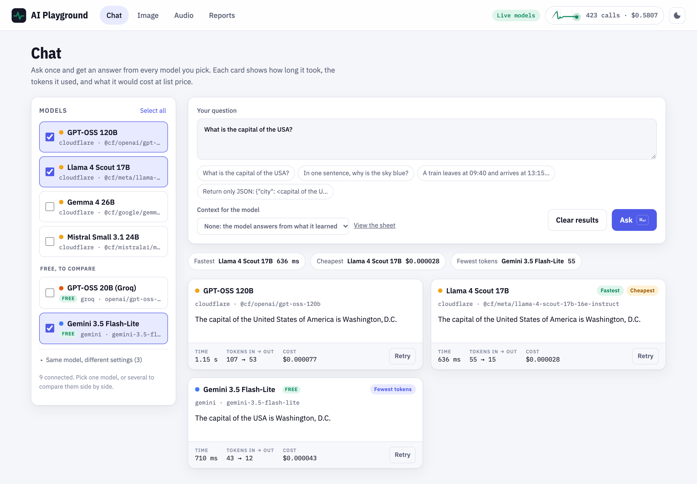

# AI Playground: a cypress-ai-vitals demo

A small app with real AI models behind it (chat, image generation, text to speech and speech to text) and a Cypress suite that tests it with [`cypress-ai-vitals`](https://github.com/anvitech12/cypress-ai-vitals). Built for the Cypress Ambassador 2026 talk *The Multimodal Madness: A Framework for Testing Text and Image LLMs with Cypress*.



## What is in here

| Path | What it is |
|---|---|
| `app/` | The AI Playground: an Express server (`app/server.ts`) and a no-build web app. Chat, Image and Audio pages, plus Reports. |
| `cypress/e2e/` | The test suite: `00-sanity`, `text`, `image`, `audio` and `techniques` (the talk's lessons). |
| `cypress/fixtures/` | Golden question sets, a brand palette and reference images. |
| `ai.env.example` | Every model the app uses, with list prices. Copy it to `ai.env` and add your keys. |
| `docs/try-it.md` | A guided tour of the app and the tests. |

## Run it

Requires Node 22+ and Google Chrome.

```bash
npm install
cp ai.env.example ai.env    # then add your keys; ai.env is gitignored
npm run app                 # http://localhost:4400
npm run cy:open             # in a second terminal
```

Or run everything headless: `npm test` starts the app and runs the suite.

### Keys and cost

Every page lists Cloudflare Workers AI models first, then one or two free models to compare (tagged **Free**).

| Provider | Used for | Free tier |
|---|---|---|
| Cloudflare Workers AI | chat, images, voices, transcription; Llama 4 Scout also judges the images | 10,000 neurons a day. The demo was built on the $5 a month Workers Paid plan. |
| Groq | GPT-OSS 20B, Whisper | yes, about 30 requests a minute |
| Google Gemini | Gemini Flash-Lite (the default judge in `ai.env`), Gemini TTS | yes; text to speech allows 10 requests a day |
| Hugging Face (optional) | a free FLUX Space | 2 GPU-minutes a day without a token, 5 with `HF_TOKEN` |

A full live run of the suite costs about $0.15 at list prices, mostly Leonardo Phoenix images. To rehearse without spending anything, record once and replay:

```bash
npm run test:record   # real models, saves every answer
npm run test:replay   # saved answers, no network
```

## The tests

```
cypress/e2e/
  00-sanity/    every page works; every model in ai.env answers
  text/         01 one model · 02 compare models · 03 arena report and thinking budget
  image/        01 one model · 02 compare models · 03 arena report
  audio/        01 one voice + Chrome live captions · 02 compare voices and listeners · 03 listener report
  techniques/   brittle vs semantic, grounding and guardrails, images need a judge,
                the flaky-AI playbook, cy.prompt() self-healing (needs a Cypress Cloud login)
  real-demo/    01 Gemini (and ChatGPT, with an OpenAI key) through their APIs
                02 the real gemini.google.com chat page: a question and a follow-up in one thread
```

`npm test` skips the gemini.google.com spec. Run it with `npm run test:real`, or `npm run cy:open:real` to sign in to your Google account first: the spec pauses until you press Resume. ChatGPT's website blocks automated browsers, so ChatGPT is tested through OpenAI's API instead.

Two technique tests show classic checks breaking on AI output (an exact-string check, a pixel snapshot). They pass when they fail for that reason, and the red check stays visible in the Command Log. The `cy.prompt()` tests need a Cypress Cloud login, so they are skipped unless you run `npm run cy:open:cloud`.

Every spec run writes an HTML report next to Cypress's videos: `cypress/ai-vitals/reports/<spec>/latest.html`.

## Keep your keys safe

- `ai.env` is gitignored. Commit changes to `ai.env.example` only, with empty values.
- Keys are read only by the server and by the Cypress plugin in Node. They never reach the browser.
- The plugin and the server replace keys and account ids with `[redacted]` in reports, recordings and error messages.

## License

MIT, see [LICENSE](LICENSE).
